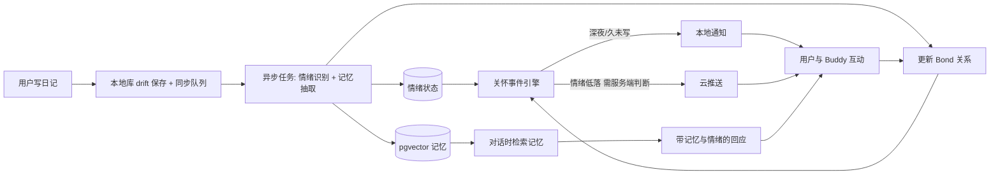

# Oneleaf 工程文档（从原型到动工 · 轻量优先版）

> 产品：Oneleaf ｜ 定位：陪伴式翻页日记（复刻 Zigi 并围绕「陪伴」创新）
> 前置输入：`Zigi-产品开发文档.md`（调研与 PRD）、`Oneleaf-产品创意说明.md`、`oneleaf-prototype/index.html`（静态原型）
> 本文目标：回答两个问题——**技术栈如何确定**、**如何一步步实施**。
> 版本 v1.2 ｜ 日期 2026-11-19 ｜ 形态：**iOS / Android 原生 App（跨端）** ｜ 第一原则：**轻量**
>
> **v1.2 更新说明**：确立「轻量」为第一优先原则——**在保证功能与交互手感不下滑的前提下，做到最小实现**。本版重新审视客户端选型（Flutter 与"极致包体积"的张力诚实呈现），新增 §5「轻量设计：目标、手段与红线」作为全项目横切约束，新增 ADR-07，并在技术栈总表、路线图、工程规范中加入可度量的轻量预算与 CI 门禁。后端方案基本不变。

---

## 0. 阅读指引与假设前提

### 0.1 这份文档解决什么

原型阶段回答的是"长什么样、能点什么"，但它是纯静态的——数据在内存里、AI 是模拟的、刷新即复位。动工要做的是把它变成**真正能长期陪伴用户的产品**：数据要存下来、Buddy 真的会思考、关怀真的会主动发生、并且能装进用户口袋随时打开——**而且要以尽可能轻的方式做到这一切**。

这份文档就是这座桥：

- **第一部分**解决「技术栈如何确定」——不是甩一张技术清单，而是展示**怎么推导出来**的，让你能判断、能改。
- **第二部分**解决「如何一步步进行」——不是笼统的里程碑，而是**可执行到任务级**的施工顺序，让你明天就知道先干什么。

### 0.2 五条假设前提（若不符，请按文中的"切换条件"调整）

| 假设 | 说明 | 如果不符 |
|------|------|----------|
| **第一原则：轻量** | 功能与交互不下滑的前提下，包体积、启动、内存、依赖、服务数全面从简 | 若某处"轻"与"手感"冲突 → **手感优先**，轻量退让（见 §5.5 红线） |
| 产品形态 | 原生 App，iOS + Android 双端（跨端框架一套代码） | 只做单端 → 见 ADR-01；想先快速验证 → 可临时用 PWA 过渡后迁移 |
| 团队规模 | 1–3 人全栈，或小型团队 | "开发轻"本身就是轻量的一部分，人少更要避免重型架构 |
| 预算 | 起步控制成本，LLM/API 按量付费；另需开发者账号年费 | 预算充足可提前上托管向量库、多模型、专业推送服务 |
| 数据合规 | 面向国内用户为主，隐私是卖点 | 出海则替换推送（FCM）、商店、存储节点与合规策略 |

> 重要原则：**起步选能快速验证「陪伴闭环」的最简组合，能力不足时再逐层替换**。不要一开始就上微服务、K8s、独立向量集群——那是规模问题的解法，不是起步问题的解法。对 App 而言，"轻量"不是功能缩水，而是**用更少的东西实现同样的体验**。

---

# 第一部分 · 技术栈如何确定

## 1. 决策方法论：技术栈是「推导」出来的

选技术栈最忌讳两种做法：一是照抄别人的清单，二是追新。正确做法是从产品约束一步步推导。我们用四步法：

```
① 产品约束  →  ② 质量属性  →  ③ 关键决策点  →  ④ 验证与回退条件
   (不能变的事)    (要优化的事)      (真正要拍板的分叉)     (选错了怎么退)
```

### 1.1 第一步：列出产品约束（来自产品定义，不可协商）

| 约束 | 来源 | 对技术的硬要求 |
|------|------|----------------|
| **轻量（第一原则）** | 用户明确要求 | 包体积/启动/内存/依赖/服务数设预算（见 §5），并被 CI 卡住 |
| 原生 App 形态，双端上架 | 本次决定 | 需 iOS/Android 客户端、开发者账号、商店审核、签名与分发 |
| 一天一页、长期留存 | 核心隐喻 | 数据必须持久化、可备份恢复；**App 需本地库做离线优先** |
| 端侧语音、不联网 | 调研确认（sherpa-onnx） | ASR 必须在设备端推理，模型应**按需下载**而非增大首装包 |
| 日记不用于训练 | 隐私卖点 | LLM 供应商要有不训练承诺，或可私有化 |
| 陪伴创新（记忆/关怀/情绪/接力） | Oneleaf 创新 | 需向量检索、异步任务、事件触发、多 Agent 编排；**需系统推送 + 本地通知** |
| 极简清新的翻页体验 | 原型设计 | 翻页 60fps、对话流畅——**这是手感红线，轻量不得牺牲**（见 §5.5） |
| 私密数据的设备级保护 | 日记产品 | 应用锁用生物识别（Face ID / 指纹），密钥存系统钥匙串 |

### 1.2 第二步：明确要优化的质量属性（按优先级排序）

0. **轻量**（新增，第一优先）——安装小、启动快、内存省、依赖少、服务少；且**不以功能和交互下滑为代价**。
1. **交互手感**（翻页、对话、动画）——第二优先，也是轻量的硬边界；手感下滑即轻量失败。
2. 陪伴感的可实现性——架构必须让"记忆、关怀、情绪"能落地。
3. 隐私与信任——日记是最私密的数据，一次泄露足以毁掉产品。
4. 研发速度与双端一致性——一套代码覆盖双端，避免行为不一致。
5. 离线可用——没网也要能写、能翻、能看。
6. 成本可控——LLM 是变动成本，必须能观测、能限流。
7. 可演进性——今天的小方案要能平滑长大。

> 注意 0 与 1 的关系：**轻量是手段，不是目的；目的是体验好且负担小**。当二者冲突时（例如砍掉动画能减小包体但手感下滑），按 §5.5 红线处理——保留手感，从别处找轻量空间。

### 1.3 第三步：识别出真正需要拍板的关键决策点

真正影响全局、后期难改的分叉只有 7 个：

1. **客户端技术栈**（Flutter / React Native / KMP / 原生双端）——决定双端效率、包体积与手感
2. **轻量预算与依赖纪律**（决定"轻"能否落地并长期保持）
3. 离线存储策略（本地数据库选型、同步机制）
4. 后端与 LLM 接入（服务数、向量检索、成本与合规）
5. 语音方案（端侧推理 + 模型按需下载的平衡）
6. 推送与发布（关怀触达 vs 依赖与体积成本）
7. 数据与服务的合并度（能用现成就不用新组件）

### 1.4 第四步：每个决策都写下「切换条件」

选型的价值不在于"选了什么"，而在于**知道什么时候该换**。每个决策卡片都带"什么时候改选"，避免教条式坚持。

---

## 2. Oneleaf 特有：陪伴创新对技术栈的额外要求

5 个陪伴创新不是 UI 装饰，每一个都会落到架构里，必须在选型时就预留位置——同时也要用轻量思维审视每一个的开销：

| 陪伴创新 | 技术需求 | 架构里必须预留的组件 | 轻量处理 |
|----------|----------|---------------------|----------|
| ① Buddy 主动关怀 | 情绪检测 + 定时触发 + 通知 | 关怀事件引擎、情绪结果、**本地通知 + 云推送** | 本地通知为主，云推送只用于需服务端判断的场景 |
| ② Buddy 长期记忆 | 记忆抽取 + 向量化 + 检索 | 异步管线、**pgvector**、RAG 管线 | 不引入独立向量库；记忆抽取批量化降低 LLM 调用 |
| ③ 默契关系 | 关系状态累积 | Bond 表 + 计数 + 升级规则 | 几张小表，开销可忽略 |
| ④ 情绪共鸣 | 情感分析 + Prompt 动态调整 | 情绪识别（复用 LLM 输出）+ 状态注入 | 复用 LLM 输出，**不引入独立情感模型** |
| ⑤ Buddy 间接力 | 多 Agent 编排 | 编排器（多轮调用、共享上下文） | 复用同一 LLM 网关，不引入 Agent 框架 |

**关键推论**：五项合起来要求一条 **"日记事件 → 异步处理 → 记忆/情绪/关系更新 → 关怀/对话 → 推送触达"** 的后台管线。所以后端**必须有异步任务和向量检索能力**——这是最硬的约束之一。但轻量原则要求：**用最少的服务实现这条管线**（pgvector 合一、队列延后、复用 LLM 网关），而不是堆一套微服务。

### 2.1 App 相比 PWA 带来的增强（改形态的核心收益）

| 能力 | 对 Oneleaf 的价值 | 技术方案 |
|------|------------------|----------|
| **系统推送** | Buddy 的关怀能出现在锁屏/通知栏——"主动关怀"的临门一脚 | APNs / FCM 或国内厂商推送 + 后端推送服务 |
| **本地定时通知** | 深夜提醒、久未写关心在设备本地触发，不依赖后端与网络 | `flutter_local_notifications` + 后台调度 |
| **离线优先** | 没网也能写日记、翻页、看历史 | 本地数据库（drift）+ 同步队列 |
| **生物识别锁** | 比密码锁更自然、更安全 | `local_auth` + 系统钥匙串 |
| **原生分享与系统能力** | 系统分享、保存相册、后台朗读 | `share_plus`、`path_provider` |
| **更好的性能与动画** | 翻页、Buddy 动效更接近原生丝滑 | Flutter Skia 渲染，60/120fps |
| **崩溃监控** | 真机崩溃可追踪 | Crashlytics / Sentry Flutter |

> 轻量视角：**本地通知是"又轻又能打"的典型**——它不用后端推送服务、不耗流量，却能覆盖"深夜/久未写"这类主要关怀场景。云推送只在确实需要服务端判断（情绪识别后触发）时才用。

陪伴闭环的数据流（注意末端推送触达，以及各处的轻量设计）：



---

## 3. 逐层技术选型（决策卡片）

每张卡片统一格式：**候选 → 权衡 → 推荐 → 什么时候改选**。推荐项即默认主线。

### 3.1 客户端技术栈（关键决策 · 本版重新审视）

| 候选 | 运行时轻量（包/启动/内存） | 开发轻量（一套代码） | 交互手感 | 团队门槛 |
|------|--------------------------|---------------------|----------|----------|
| ① **Flutter** | 中：包偏大（引擎内置），但可优化控制 | **高**：一套代码双端 | **高**：自绘动画优秀 | 中，需学 Dart |
| ② React Native | 中：含 JS runtime，包与内存不占优 | 高：复用 JS/TS | 中：复杂动画与手势更费劲 | 低 |
| ③ **KMP**（共享逻辑 + 原生 UI） | **高**：包接近原生，无额外引擎 | 中：逻辑共享，UI 两套 | 高：原生 UI | 高，需两套原生 |
| ④ 原生双端（Swift + Kotlin） | **最高**：包最小、启动最快、内存最低 | **低**：两套代码、成本翻倍 | 最高 | 高 |

**权衡说明**：这里存在一个真实张力——**开发最轻的（Flutter）不是运行时最轻的（原生）**。用户要求"轻量第一"，但同时也要求"功能与交互不下滑"，且前提是 1–3 人的小团队。若选原生双端，运行时最轻，但两套 UI 让开发量与出错面翻倍，反而违背"轻量"精神；若选 Flutter，一套代码、手感好，包体积可通过 §5 的手段压到可接受范围。

| 项 | 内容 |
|----|------|
| **推荐** | **Flutter 3 + Dart，并施加 §5 的轻量纪律**——它是"开发轻 + 手感好 + 运行体积可控"三者的最佳平衡；包体积目标见 §5.1，通过按需下载、依赖裁剪等手段达成 |
| 什么时候改选 | ① 若**运行时轻量绝对优先**（如目标市场是低端机、流量敏感地区）且预算/人力可支撑 → 选 **KMP**（共享逻辑 + 原生 UI，包接近原生）；② 只做单端且追求极致 → 原生（先 Swift 或 Kotlin） |

> 决策理由一句话：**轻量不是"选包最小的技术"，而是"用最少的总体投入交付同样好的体验"**。Flutter 让小团队用一套代码做到手感不下滑，运行时体积通过纪律管理，这是综合最优。若你更看重绝对包体积，KMP 是值得认真考虑的升级路径（见 ADR-07）。

### 3.2 客户端内部分层（Flutter 内怎么组织 · 轻量选型）

| 项 | 内容 | 轻量取舍 |
|----|------|----------|
| 状态管理 | **Riverpod**（编译器生成、无运行时反射） | 不引入 Bloc/Redux 等更重方案 |
| 路由 | **go_router**（Flutter 官方生态、无额外原生依赖） | 不引第三方重型路由 |
| UI/动画 | **Flutter 内置 AnimationController / PageView** 实现翻页 | 不引入动画库，内置能力足够达到同样手感 |
| 本地数据库 | **drift（SQLite）**——单库存日记/会话/Bond 缓存 | 不引入 Isar/ObjectBox 等额外引擎；一张库搞定 |
| 轻量配置 | `shared_preferences` | 仅存设置项，不塞业务数据 |
| 网络层 | `dio` + 统一拦截器 | 单库复用，不重复造轮子 |
| 图标 | **字体图标 / 矢量**，不用 PNG 图片 | 直接减小包体积 |
| 设备能力 | `local_auth`、`flutter_tts`、`share_plus`、`flutter_local_notifications` | 按需引入，每个都要过 §5.4 依赖审查 |

### 3.3 后端语言与形态

| 项 | 内容 |
|----|------|
| 候选 | ① Node.js + NestJS　② Python + FastAPI　③ Go |
| 权衡 | AI/LLM 生态 Python 最丰富（但重）；Node.js 与 TypeScript 全栈复用、异步 IO 适合对话与事件管线；Go 性能好但 AI 生态弱、开发慢 |
| **推荐** | **Node.js 20 + NestJS + TypeScript**——异步逻辑好写、生态够用。**全程单进程起步**，不拆微服务 |
| 什么时候改选 | 重度自研模型/数据处理 → 增设 Python FastAPI 作为 AI 微服务；个人开发者可用 Hono/Fastify 替代 NestJS 进一步减重 |

### 3.4 数据库与向量检索（关键决策 · 轻量的典型体现）

| 项 | 内容 |
|----|------|
| 候选 | ① PostgreSQL + pgvector（合一）　② PostgreSQL + 独立向量库　③ MongoDB + 向量库 |
| 权衡 | 日记是强结构化数据，关系型更合适；起步单用户记忆量很小（数千级），pgvector 完全够用且**少运维一个服务**；独立向量库要等规模真正上来才有价值 |
| **推荐** | **PostgreSQL 16 + pgvector**——一个库存业务数据 + 向量记忆 + 队列表（起步用 DB 表 + 定时轮询，暂不上 Redis/BullMQ） |
| 什么时候改选 | 向量超百万级、或检索 QPS 成瓶颈 → 迁 Qdrant/Milvus；队列压力大 → 再引入 Redis + BullMQ |

> 这就是轻量的核心手法：**用现成的东西多做事**。起步阶段连 Redis 都可以不上，用 PostgreSQL 里的表 + 定时扫描就能撑住异步管线，省一整套服务。

### 3.5 LLM 接入方式（关键决策）

| 项 | 内容 |
|----|------|
| 候选 | ① 直连单一 API　② 自研轻量网关多模型　③ 第三方聚合平台 |
| 权衡 | 直连最简单但供应商锁定、成本不可控；网关能统一鉴权、限流、成本统计、模型热切换，且是"不用于训练"承诺的技术支点；聚合平台省事但合规受制于人 |
| **推荐** | **内嵌在主后端里的轻量 LLM 网关**（约一个模块，不是独立服务），统一 `/chat`、`/embed`，起步接一家有不训练承诺的模型 |
| 什么时候改选 | 无后端人力 → 先用聚合平台快速验证，保留接口抽象即可迁移 |

> 网关还要兑现"日记不用于训练"：统一脱敏、选不训练的模型、记录审计。商店审核会查隐私实践，这是必须保留的重量，不能为了轻而砍。

### 3.6 语音方案（隐私卖点 + 轻量平衡）

| 项 | 内容 |
|----|------|
| 候选 | ASR：① 端侧 sherpa-onnx（Flutter 插件）　② 云 ASR；TTS：① 系统 TTS　② 云 TTS |
| 权衡 | App 上 sherpa-onnx 官方 Flutter 插件端侧推理比 PWA 的 WASM 更快更稳；但**模型文件有几 MB~几十 MB**，若随包发布会直接推高首装包体；云 ASR 违背"不联网"承诺；系统 TTS 零成本、离线可用 |
| **推荐** | **端侧 ASR：`sherpa-onnx` Flutter 插件 + 量化模型（int8）按需下载**——首次点语音时才下载，**不进首装包**；**TTS：`flutter_tts` 系统合成**（无模型下载） |
| 什么时候改选 | 低端机识别太慢 → 提供"云识别（可选）"开关，默认仍端侧；模型下载失败要有清晰引导 |

> 这是"轻且不降级"的关键设计：**语音能力完整保留，但把模型的重量从"首装"移到"按需"**。用户不点语音，永远不下载模型。

### 3.7 推送、存储、发布与其他基础设施（轻量选型）

| 层 | 推荐 | 轻量理由与切换条件 |
|----|------|--------------------|
| **推送** | **本地通知为主**（`flutter_local_notifications`），云推送只用于服务端判断的关怀（APNs / 国内厂商聚合 / FCM） | 本地通知零后端成本，覆盖主要场景；云推送按需引入，避免一开始就上推送服务 |
| **本地数据库** | drift（SQLite）单库 | 离线优先的基石，不叠加第二个本地存储引擎 |
| 对象存储 | 腾讯云 COS（S3 兼容），服务端转换 WebP/AVIF | 图片走云端与缓存，不进包体 |
| 图片处理 | 服务端 `sharp` 转码 + 缩略图；客户端 `cached_network_image` 只缓存最近 N 页 | 控制流量与本地占用 |
| 地图 | 高德地图插件（`amap_flutter_map`） | **只在天气页地点选择处用**；若该处可用轻量文本选择替代，则可不引入地图 SDK（省数 MB） |
| 任务队列 | **起步：PostgreSQL 表 + 定时扫描**；量大再 Redis + BullMQ | 省一套中间件；延迟任务用 DB 轮询足够 |
| 崩溃监控 | Sentry Flutter（一个 SDK，兼具错误与性能） | 不叠加多个监控 SDK |
| 发布 | TestFlight / Firebase / 蒲公英内测 → App Store + 国内安卓商店 | 用官方分发工具，不引入额外平台 |
| 后端部署 | Docker Compose 单节点起步 | 不上 K8s；用户量上来再说 |

---

## 4. 推荐技术栈总表（轻量优先 · 默认主线）

| 层 | 选型 | 轻量标注 |
|----|------|----------|
| **客户端** | Flutter 3 + Dart，一套代码双端 | 开发轻；包体积受 §5 预算约束 |
| 客户端内部 | Riverpod + go_router + drift + dio + 内置动画 | 无重型库、无多余引擎 |
| **轻量机制** | 按需下载模型、deferred components、依赖审查、CI 体积门禁 | §5 的核心抓手 |
| 推送/通知 | 本地通知为主 + 云推送按需 | 先省掉推送服务 |
| 设备能力 | local_auth、flutter_tts、share_plus | 按需引入 |
| 后端 | Node.js 20 + NestJS + TypeScript，单进程 | 不拆微服务 |
| 数据库 | PostgreSQL 16（pgvector + 队列表），**起步不上 Redis** | 一个库承担三职 |
| LLM | 主后端内嵌轻量网关 | 不是独立服务 |
| 语音 | sherpa-onnx Flutter 插件（量化模型按需下载）+ flutter_tts | 模型不进首装包 |
| 存储/CDN | 腾讯云 COS + WebP/AVIF | 图片不进包体 |
| 地图 | 高德地图（仅地点选择处，可评估文本替代） | 可裁剪的重依赖 |
| 监控 | Sentry Flutter + 后端日志 | 单一 SDK |
| 发布 | 官方内测分发 → 商店 | 无额外平台 |

**可替换点**：Flutter↔KMP（追求极致包体积时）、drift↔更轻方案、队列表↔BullMQ、云推送服务选型。

---

## 5. 轻量设计：目标、手段与红线（本版核心）

> 本章是全项目的横切约束。轻量不是"少做功能"，而是**在功能与手感不下滑的前提下，用更少的东西达成同样体验**。

### 5.1 可度量的轻量目标（写进验收，不靠感觉）

| 维度 | 目标 | 度量方式 |
|------|------|----------|
| 首装包体积 | Android（AAB 按设备切片）≤ 20MB；iOS（App Thinning 后）≤ 25MB | CI 构建产物测量 |
| 冷启动到可交互 | 中端机 ≤ 2s | 真机埋点，Sentry 性能监控 |
| 内存峰值 | 日常使用 ≤ 200MB | 真机 Profiler |
| 首启流量（不含可选模型） | ≤ 30MB | 抓包统计 |
| Flutter 插件数 | ≤ 15 个 | 依赖清单审查 |
| 后端常驻服务 | ≤ 2 个（api + postgres） | 部署清单审查 |
| 图片缓存 | 只缓存最近 7 天封面，超出自动清理 | 缓存策略配置 |

> 这些数字是起步目标，可按实际设备修改，但**必须有数字**——没有预算的"轻量"只是口号。

### 5.2 客户端轻量化手段（按收益排序）

**包体积**
- 语音模型 **int8 量化 + 按需下载**，不随包发布（§3.6）
- 图标全部用**字体图标 / 矢量**，不打包 PNG 序列
- 手写字体只保留 1 套核心字体；其他字体按需下载（字体文件可达数 MB）
- 低频模块（Buddy 市场、创建向导、陪伴手册的深层页）用 Flutter **deferred components 按需下载**（Android 支持良好）
- 启用 `--obfuscate --split-debug-info`（混淆并外置符号表，减小产物）
- 每引入一个插件前过 §5.4 审查，能自己用内置能力实现就不引

**启动速度**
- 首屏只读本地库（drift），网络同步延后到首屏渲染后
- 推送注册、语音引擎初始化、LLM 相关逻辑延迟到用到时再初始化
- 启动图用轻量矢量/单色

**运行内存与流畅**
- 翻页只**预取相邻 1 页**封面，不预加载整月
- 对话消息分页 + 懒加载（`ListView.builder`），只渲染可视区
- 图片缓存设上限并定期清理（最近 7 天）
- 动画用 Flutter 内置 `Transform`/`Opacity`，避免重建整棵 Widget 树

### 5.3 后端与架构轻量化

- **一个 PostgreSQL 承担**：业务数据 + 向量记忆 + 队列表（起步不引入 Redis、不引入独立向量库）
- **LLM 网关内嵌主后端**，不单独部署
- **记忆抽取批量化**：多条日记攒批处理，降低 LLM 调用量与费用
- **云推送延后**：先用本地通知覆盖"深夜/久未写"，只在"情绪低落"这类需服务端判断的场景用云推送
- **功能分层**：核心（日记/陪伴闭环/语音/推送）随包；增强（市场/创建/开发平台）按需下载或走 H5
- 封面图库起步用**精选 60–100 张**（内容量而非功能缩水，全部云端存储、不占包体），后续云端扩充

### 5.4 依赖准入纪律（让轻保持住）

每个新依赖入库前必须回答三个问题：
1. **是否必需？** 能否用 Flutter 内置能力或已有依赖实现？
2. **重量多少？** 包体积增量、原生依赖数量、启动开销、是否引入新引擎？
3. **有无更轻替代？** 例如：地图 SDK vs 文本地点选择、动画库 vs 内置动画、独立向量库 vs pgvector。

**CI 门禁**：包体积超预算、插件数超预算即构建失败；依赖新增需在 PR 中说明重量评估。

### 5.5 红线：轻量的边界（这些不能砍）

轻量**不得**以牺牲以下能力为代价——它们是产品存在的原因：

| 不可让步 | 原因 |
|----------|------|
| 翻页手感与动效（60fps） | 核心体验，手感下滑=轻量失败 |
| Buddy 陪伴闭环（记忆/关怀/情绪/接力） | 产品灵魂 |
| 端侧语音（不联网） | 隐私卖点，用户承诺 |
| 主动关怀的推送触达 | 陪伴价值的关键一环 |
| 离线可写 | 日记产品的底线 |
| 隐私承诺（不用于训练、生物锁、本地加密） | 信任基础 |

> 当轻量与红线冲突时：**保留红线，从别处找空间**。例如不能通过"砍掉语音"来减包体，而应通过"语音模型按需下载"来减首装包。

---

## 6. 架构决策记录（ADR）

### ADR-01：采用 Flutter 跨端原生 App，双端一套代码（轻量权衡后维持）

- **背景**：产品要做原生 App、覆盖 iOS/Android、团队 1–3 人；核心体验是翻页动画、定制视觉与端侧语音；用户要求轻量第一。
- **决策**：维持 Flutter，一套代码双端，并施加 §5 轻量纪律。
- **后果**：开发轻、手感好、端侧 ML 支持好；包体积偏大需靠按需下载等手段控制，需持续预算管理。
- **备选**：KMP（运行时更轻但需两套 UI、门槛高）、原生双端（最轻但成本翻倍）、React Native（JS 生态复用但动画/ASR 更费劲）。
- **复评条件**：若目标市场低端机占比高、包体积超预算且优化无效 → 迁 KMP（共享逻辑 + 原生 UI）。

### ADR-02：PostgreSQL + pgvector 合一，起步不引入 Redis/独立向量库

- **背景**：记忆需向量检索，但有异步管线需求；轻量要求少服务。
- **决策**：一个 PostgreSQL 承担业务数据、向量记忆、队列表；Redis/BullMQ 延后。
- **后果**：运维最简、成本最低；规模上来后需迁移。
- **复评条件**：向量 > 100 万条、检索成瓶颈、或队列吞吐不足。

### ADR-03：LLM 通过内嵌轻量网关接入，日记不用于训练

- **背景**：日记极私密，官网与商店都要求隐私承诺。
- **决策**：网关作为主后端的一个模块（非独立服务），统一脱敏、审计、模型切换。
- **后果**：几乎无额外重量，换来合规与成本可控。

### ADR-04：端侧 ASR 为默认，模型按需下载

- **背景**："语音不联网"是隐私卖点；模型文件会推高包体。
- **决策**：sherpa-onnx Flutter 插件 + int8 量化模型，首次使用时下载，不进首装包；系统 TTS。
- **后果**：既守住隐私承诺，又不让首装包变重；需处理首次下载体验。

### ADR-05：以「陪伴闭环」为第一个垂直切片

- **决策**：第一个目标是纵向打通"写日记→情绪/记忆→关怀/对话→关系更新→推送触达"，而非先做完所有页面。
- **后果**：最早验证产品灵魂，风险前置。

### ADR-06：离线优先——本地数据库为真相源，联网后同步

- **决策**：drift（SQLite）为本地真相源，写入即落本地，再由同步队列补传服务端。
- **后果**：离线可用、体验流畅；增加同步与冲突处理复杂度。这是 App 版日记的基线要求。

### ADR-07：轻量为第一原则，设可度量预算与 CI 门禁

- **背景**：用户明确轻量优先，且要求功能与交互不下滑。
- **决策**：确立 §5 的轻量预算（包体/启动/内存/依赖/服务数）、依赖准入纪律、CI 体积门禁；冲突时按 §5.5 红线"手感优先，轻量退让"。
- **后果**：产品负担小、启动快、成本省；需持续维护预算与审查，增加一点流程成本。
- **备选**：运行时极致轻量 → KMP/原生（开发成本翻倍）；纯追开发速度 → 不管体积（违背用户要求）。
- **复评条件**：若某阶段轻量预算严重拖累进度，可临时放宽数值，但不得突破 §5.5 红线。

---

# 第二部分 · 如何一步步进行

## 7. 总体实施策略

### 7.1 垂直切片优先，不要水平分层

常见错误是"先把数据库全建好、再把所有 API 写完、最后接客户端"——这样要到最后才能看到效果。

我们采用**垂直切片**：每一轮交付一个"从界面到本地存储到后端到 AI 全打通"的小闭环，能在真机上跑、能点、能验证：

```
切片 0：App 能启动、能翻页、写一页存本地（离线可用）      （先让"日记"在口袋里活起来）
   ↓
切片 1：本地日记 → 同步服务端 → 多端/重装不丢
   ↓
切片 2：日记 → 情绪识别 → Buddy 主动关怀 + 推送触达       （第一个"陪伴"瞬间）
   ↓
切片 3：Buddy 对话（带记忆、带情绪、有关系）              （陪伴闭环完整）
   ↓
切片 4：天气/日历/封面/语音/分享/市场/创建 ...              （补齐所有页面功能）
   ↓
切片 5：开发平台（PAL/Mojito/RAG 控制台）                  （护城河，第二阶段）
```

> 切片 2 和 3 合起来是第 2 节那条"陪伴闭环"，**必须最先打通**；App 形态下还要把"推送触达"一起做掉。每个切片都要过一次轻量体检（§5）。

### 7.2 每个切片的统一节奏

```
设计评审 → 本地数据模型 → 后端接口+数据 → 客户端页面 → 联调 → 真机自测 + 轻量体检 → 内测包演示 → 下一个切片
```

### 7.3 三条铁律

1. **每个阶段必须可在真机演示**：模拟器不算数。
2. **数据先于界面**：先定真实数据结构（含本地库），假数据逐步替换。
3. **陪伴优先于完整**：时间不够时，砍页面不砍陪伴闭环；**轻量优先于花哨**，但不碰红线。

---

## 8. 阶段路线图（详细到任务级）

以 2 周为一个 Sprint。9 个阶段（Phase 0–8），每阶段含目标、任务、交付物、验收标准、退出条件。**每个 Phase 末尾都有轻量检查项。**

---

### Phase 0 · 准备周（W1 前，3–5 天）

**目标**：决策固化、账号证书备齐，并**定下轻量预算基线**。

- [ ] 确认第 4 节技术栈总表，尤其客户端框架与轻量目标（§5.1）
- [ ] 注册账号：Apple Developer、Google Play、国内安卓商店、云服务、地图 API、LLM API、Sentry
- [ ] 准备签名材料：iOS 证书/描述文件、Android keystore（绝不入库）
- [ ] 建代码仓库、分支保护、CI 骨架；**CI 中加入包体积测量与依赖计数**
- [ ] 初始化 Flutter 项目，配色整理为 ThemeData + 设计 token
- [ ] 准备测试真机：至少 1 台 iOS + 1 台 Android（**含一台中低端机**用于轻量测试）
- [ ] 建 `decisions/` 存 ADR，`docs/` 存文档

**轻量检查**：写下本项目轻量预算基线（§5.1 数值按实际调整），录入 CI。
**交付物**：双端可启动骨架 + 后端健康检查 + CI 绿灯 + 轻量预算基线。
**退出条件**：真机能启动 App，后端可访问，CI 报告包体积与依赖数。

---

### Phase 1 · 地基与离线日记（W1–W2）

**目标**：本地库 + 认证 + 日记 CRUD，离线也能写（切片 0 + 1）。

- [ ] Prisma 建服务端表：`user`、`diary_page`、`image`、`secure_code`、`device_token`
- [ ] drift 建本地表：`diary_page`、`pending_sync`、`settings`（**本地只存必要字段**）
- [ ] 安全码认证 API；日记 CRUD API；一天一页唯一约束
- [ ] 客户端：原生启动页 + 导航 + go_router
- [ ] 日记页写作区 + 写本地库 + 同步队列补传
- [ ] 生物识别锁 `local_auth` 接入

**轻量检查**：本地表无冗余字段；首屏只读本地库、网络同步延后；包体 ≤ 基线。
**交付物**：能注册、断网可写、联网同步、生物锁解锁的 App。
**验收标准**：断网写日记 → 退出重进仍在 → 联网后服务端可见。
**退出条件**：切片 0/1 真机演示通过。

---

### Phase 2 · 陪伴闭环核心（W3–W6）★最关键阶段

**目标**：打通陪伴闭环含推送触达（切片 2 + 3）。

- [ ] 服务端建表：`buddy`、`conversation`、`reply`、`subscription`、`memory`、`bond`、`emotion_state`、`care_event`
- [ ] 预置 3 个官方 Buddy（Ben、Tina、倾听者）
- [ ] LLM 网关（内嵌模块）：`/chat`、`/embed` + 限流 + 成本日志
- [ ] Buddy 引擎：persona + 用户画像 → prompt → LLM → 会话
- [ ] 异步管线（**起步用 DB 表 + 定时扫描，不上 Redis**）：情绪识别 + 记忆抽取 → pgvector → Bond
- [ ] 记忆检索：对话时 RAG 注入 + 记忆引用卡
- [ ] 情绪共鸣：情绪状态注入 system prompt
- [ ] 关怀引擎 + **本地通知为主、云推送仅用于服务端判断场景**
- [ ] 客户端：对话页 + "Buddy 悄悄话"卡 + 陪伴手册页

**轻量检查**：未引入 Redis/独立向量库/Agent 框架；云推送依赖按需；记忆抽取批量化。
**交付物**：Buddy 主动关怀（能收到通知）、对话引用过去、关系累积。
**验收标准**：
1. 情绪低落日记 → 主动关怀且锁屏收到通知；
2. 对话提"想去海边" → 几天后 Buddy 提起；
3. 多次互动 → 默契上升、回应更贴合。
**退出条件**：三项全通过。**若延期，宁可砍页面也不砍此阶段。**

---

### Phase 3 · 日记体验完善（W7–W8）

**目标**：翻页体验、封面、日历、天气、多 Buddy。

- [ ] PageView + 内置动画翻页 + **相邻 1 页预取** + 图片缓存（60fps）
- [ ] 封面图库（精选 60–100 张，云端分页）+ 多图切换 + 圆点指示
- [ ] 图片上传：服务端 sharp 转 WebP/AVIF + 缩略图；客户端压缩上传
- [ ] 日历页：状态标记 + Buddy 陪伴足迹
- [ ] 天气页：高德/天气 API，24h + 5 天预报（**评估能否用文本地点选择替代地图 SDK**）
- [ ] 多 Buddy 同页：`@` 分段映射 + 独立线程 + 接力提示

**轻量检查**：翻页帧率达标；只预取相邻页；图片缓存 ≤ 7 天；地图 SDK 是否必要有结论。
**交付物**：接近原型完整度的日记主体验。

---

### Phase 4 · 语音与工具能力（W9–W10）

**目标**：端侧语音卖点 + 服务型 Buddy，且**不增加首装包重量**。

- [ ] sherpa-onnx Flutter 插件 + **int8 量化模型按需下载**（不进包）
- [ ] 首次使用引导下载 + 失败处理；启动性能探测与降级
- [ ] 标点模式与转录模式（端侧）
- [ ] flutter_tts：Buddy 朗读回应 + 朗读日记（后台播放）
- [ ] 结构化服务卡片：记账汇总、穿搭建议
- [ ] 真实录音 + 端侧转写（飞行模式可用）

**轻量检查**：首装包体积无显著增长（模型按需）；量化模型体积记录归档。
**验收标准**：飞行模式仍可语音输入与识别；"记账"返回结构化卡；包体仍 ≤ 基线。

---

### Phase 5 · 生态与分享（W11–W12）

**目标**：UGC 与传播能力，低频页面**按需加载**。

- [ ] Buddy 市场：分类/搜索/订阅 + 陪伴天数/默契度
- [ ] 创建 Buddy 三步向导
- [ ] 分享：只读 H5 页 + 匿名 + 计数；App 内系统分享面板
- [ ] 设置：账号、生物锁、字体、隐私开关
- [ ] **低频模块（市场/创建/深层陪伴手册）评估用 deferred components 按需下载**

**轻量检查**：新页面未显著推高首装包；字体按需下载；依赖清单仍在预算内。
**交付物**：覆盖原型 10 个页面且首装包不超标。

---

### Phase 6 · 角色开发平台（W13–W16，护城河/第二阶段）

**目标**：对应 Zigi 开发者平台。**以移动 Web / 独立站点实现，不塞进 App**——这是重要的轻量决策。

- [ ] Secure Code 开发者登录
- [ ] 角色设计面板、Prompt 编辑器 + 单步调试器、RAG 控制台、审核发布流程

**轻量检查**：开发平台不进入 App 安装包；App 内只留一个入口链接。
**说明**：差异化护城河但非 MVP 必需，资源紧张时整体后移到 V2。

---

### Phase 7 · 商店发布准备与内测（W17–W18）

**目标**：从"能用"到"敢给陌生人用"，走完上架。

- [ ] 性能：冷启动 ≤ 2s、翻页 60fps、对话首字 < 3s、包体积达标（§5.1）
- [ ] 稳定性：Sentry 崩溃/性能监控、备份恢复演练
- [ ] 隐私合规：隐私政策、**iOS Privacy Manifest / Android Data Safety**、权限最小化、"不用于训练"审计
- [ ] 成本与限流：LLM 预算告警、单用户配额、推送频率上限
- [ ] 双语、商店素材（截图/描述/分级/审核账号）
- [ ] 内测分发：TestFlight + Firebase/蒲公英，收集反馈修复；提交商店审核（预留 1–2 周）

**轻量检查**：发布前最终体积/启动/内存测量达标，依赖数达标，未超预算。
**交付物**：通过审核、可下载的 v1.0。

---

### Phase 8 · 正式上线与迭代（W19 起）

- [ ] 灰度/全量发布，功能开关可秒关敏感能力
- [ ] 监控留存、关怀触达、记忆命中、崩溃率、**包体积与启动时间趋势**
- [ ] 每次迭代都过轻量体检，防止功能累积让 App 变臃肿（**防肥胖机制**）

---

### 8.1 阶段依赖与裁剪建议

```
Phase 0 → 1 → 2(灵魂) → 3 → 4 → 5 → 6(可选) → 7 → 8
```

| 资源情况 | 建议范围 |
|----------|----------|
| 个人/极简 | Phase 0–2（含推送）+ Phase 3 核心，**先上内测版验证陪伴闭环** |
| 小团队标准 | Phase 0–5 + 7 + 8，开发平台作为 V2 |
| 资源充足 | 全量，Phase 6 与 Phase 3–5 并行 |

---

## 9. 第一个 Sprint 的逐日计划（W1，示例）

| 天 | 上午 | 下午 | 当天产出 |
|----|------|------|----------|
| D1 | 初始化 Flutter 双端项目 + 后端 NestJS + CI 骨架 | 配 Prisma 连 PostgreSQL，建首个 migration；**CI 加体积测量** | 双端启动、后端可访问、CI 报告体积 |
| D2 | 设计 token + ThemeData（原型配色） | 应用外壳：原生启动页 + 导航 + go_router | 轻量导航骨架 |
| D3 | drift 本地表 + 服务端表 + 注册/验证接口 | 登录页 + 安全码流程 | 能注册登录 |
| D4 | diary CRUD + 唯一约束测试 | 写作区 + 写本地库 + 同步队列联调 | 断网写、联网同步 |
| D5 | 接生物识别锁 + 错误态 | 真机自测（iOS+Android+低端机）+ 轻量体检 + 演示 | 切片 0/1 可演示，体积达标 |

> 每个 Sprint 按此粒度拆解，真机演示 + 轻量体检双验收。

---

## 10. 工程规范（动工前先定）

### 10.1 仓库结构（monorepo）

```
oneleaf/
├── apps/
│   ├── mobile/       # Flutter App（iOS + Android）
│   │   ├── lib/
│   │   │   ├── core/       # 主题、网络、存储、推送
│   │   │   ├── features/   # diary / buddy / weather / care ...
│   │   │   └── generated/  # drift / 代码生成
│   │   ├── ios/  android/
│   │   └── integration_test/
│   └── api/          # 后端单进程服务
├── packages/
│   ├── shared/       # 前后端 API 契约/DTO
│   └── design_tokens/
├── prisma/
├── docs/             # 本工程文档、PRD、原型说明
├── decisions/        # ADR
├── build_budget.json # 轻量预算与体积基线（§5.1）
├── docker-compose.yml
└── .github/workflows/ # CI/CD + 体积门禁 + App 构建分发
```

### 10.2 分支、提交与依赖

- 分支：`main` + `develop` + `feature/*` + `fix/*`；Conventional Commits。
- **依赖准入**：新增依赖需在 PR 说明重量评估（§5.4）；CI 检查插件数与包体积，超预算失败。

### 10.3 测试策略

- 单元测试：Buddy 引擎、关怀规则、记忆抽取、同步冲突（Dart `test` + Jest）。
- Widget 测试：关键页面渲染与交互（`flutter_test`）。
- 集成测试：真机/模拟器跑陪伴闭环（`integration_test`），至少覆盖 1 台 iOS + 1 台 Android + 1 台低端机。
- 视觉回归：原型截图做基线，防止改版走样。
- **性能回归**：冷启动、包体积、翻页帧率纳入 CI 或定期测量。

### 10.4 CI/CD 与环境

- CI：lint → analyze → test → build → **体积/依赖门禁**；绿灯才能合并。
- CD：自动打内测包上传 TestFlight / Firebase App Distribution（签名走 CI Secrets）。
- 环境：`dev` / `staging`（内测包）/ `prod`（正式包）；密钥绝不入库。
- 双端版本同步发版，注意商店审核时间差。

### 10.5 数据与配置

- 服务端迁移用 Prisma Migrate，本地库用 drift migration，禁止手改线上/用户数据。
- 同步冲突：更新时间戳为主，服务端最终一致，冲突可追溯。
- Feature Flag：敏感能力可秒关（App 发版慢，开关尤其重要）。
- 日志带 `requestId` 贯穿客户端与后端。

---

## 11. 数据模型落地（在调研版 ER 上补充）

| 新增/扩展 | 关键字段 | 支撑的能力 |
|-----------|----------|-----------|
| `emotion_state` | `page_id`, `score`, `label`, `detected_at` | 情绪共鸣、主动关怀 |
| `memory` | `user_id`, `buddy_id`, `content`, `embedding(vector)`, `source_page_id`, `created_at` | 长期记忆（RAG） |
| `bond` | `user_id`, `buddy_id`, `days`, `interaction_count`, `level`, `updated_at` | 默契关系 |
| `care_event` | `user_id`, `buddy_id`, `trigger_type`, `message`, `sent_at`, `read_at` | 主动关怀 |
| `device_token` | `user_id`, `platform`, `token`, `updated_at` | 云推送（按需引入时） |
| `conversation` 扩展 | `emotion_snapshot`、`memory_refs` | 情绪共鸣、记忆引用卡 |
| `buddy` 扩展 | `capabilities` 增加 `memory` / `proactive_care` 开关 | 创建 Buddy 新能力 |

**轻量约束**：`memory.embedding` 用 `vector(1536)`（维度随嵌入模型调整，维度越低越省，可选小模型）；HNSW 索引加速检索；队列表只存必要字段；本地库仅缓存最近 7 天数据。

---

## 12. 质量、隐私、成本与轻量预算

### 12.1 隐私（陪伴产品的生命线）

- 日记传输 TLS、静态加密；LLM 调用前脱敏；"不用于训练"写进隐私政策并架构兑现。
- 生物锁密钥存系统钥匙串；**本地日记文件加密**防设备破解后直接读取。
- 上线前提供数据导出/删除；商店提交 iOS Privacy Manifest / Android Data Safety，权限最小化。

### 12.2 成本与限流

- 网关记录 token 与费用，按用户/日统计；单用户配额与全局预算告警；超限降级。
- 记忆抽取批量化降低 LLM 调用；推送频率上限避免打扰与成本失控。

### 12.3 轻量预算（持续跟踪）

- §5.1 各项指标录入 `build_budget.json`，CI 每次构建对比基线。
- 每次迭代做轻量体检，防止功能累积让 App 变臃肿。
- 关键指标：包体积、冷启动、内存峰值、依赖数、后端服务数，以及体验指标（翻页帧率、对话响应、关怀触达、留存、崩溃率）。

---

## 13. 决策清单与下一步

### 13.1 需要你拍板的 6 个问题

1. **客户端框架**：维持 Flutter（综合最轻）？还是为极致包体积改 KMP / 单端原生？
2. **轻量目标数值**：§5.1 的包体积/启动/内存目标是否符合你的目标市场（尤其是否面向低端机、流量敏感地区）？
3. **双端还是单端**：先做 iOS + Android 双端，还是先做一端验证？
4. **后端与模型**：接受 Node.js + 有不训练承诺的模型供应商吗？
5. **地图与语音**：天气页能否用文本地点选择替代地图 SDK（省数 MB）？语音接受"首次按需下载模型"吗？
6. **开发平台（Phase 6）**：放 V1 还是 V2？（建议 V2，走 Web 不进 App 包）

### 13.2 立即可执行的三步

1. 今天：确认上面 6 个问题 → 我把 ADR 与轻量预算定稿，锁定版本。
2. 明天：按 Phase 0 建仓库、注册账号、初始化 Flutter 双端骨架，**并在 CI 中建立体积与依赖基线**。
3. 本周内：完成 Phase 1 切片 0/1——真机上能写、离线存、联网同步、翻页，且体积达标的第一版。

---

## 附录 A · 三份文档的关系

| 文档 | 回答的问题 | 阶段 |
|------|-----------|------|
| `Zigi-产品开发文档.md` | 原产品是什么、竞品、功能与技术方案调研 | 调研 |
| `Oneleaf-产品创意说明.md` | 我们做什么、保留什么、创新什么、页面长什么样 | 产品定义 + 静态原型 |
| **本文 `Oneleaf-工程文档.md`** | **技术栈怎么定、怎么做到轻、按什么顺序建** | **工程实施（轻量优先）** |

## 附录 B · 关键术语

| 术语 | 含义 |
|------|------|
| 轻量优先 | 功能与手感不下滑前提下，用最少投入达成同样体验 |
| 轻量预算 | 包体/启动/内存/依赖/服务数的可度量目标，CI 卡控 |
| 依赖准入 | 新依赖入库前的必要性/重量/替代评估 |
| deferred components | Flutter 按需下载的功能模块，减小首装包 |
| 陪伴闭环 | 写日记→情绪/记忆→关怀/对话→关系更新→推送触达 |
| 离线优先 | 本地库为真相源，写入即落本地，联网后同步 |
| RAG | 检索增强生成：先检索记忆，再让 LLM 据此回答 |
| pgvector | PostgreSQL 的向量检索扩展 |
| ADR | 架构决策记录，记录"为什么这么选" |
| APNs / FCM | 苹果 / 谷歌系统推送；国内安卓需厂商通道保活 |
| Feature Flag | 功能开关，可灰度、可秒关 |

---

*文档结束 · 建议与原型、PRD 配套阅读 · 需要我帮忙搭 Flutter 骨架与轻量门禁时随时说*
